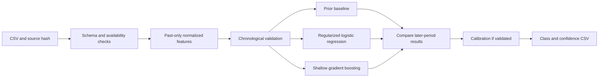

# BigShort Winners

## KESTREL: three rounds, one research foundation

A collaborative modeling project for classification, bounded prediction and cost-aware trading evaluation. We start with reproducible data checks and chronological validation, then compare models against simple baselines.

**Current stage:** round-one dataset audited locally; architecture proposed. No classifier has been trained and no submission has been generated. Competition scoring rules have not yet been provided.

| Round | Objective | Output / evaluation |
| --- | --- | --- |
| 1 | Binary classification | Prediction in `{0, 1}` plus confidence |
| 2 | Bounded prediction with deliberately generated crashes | Prediction in `[-1, 1]`; target meaning and scoring to be confirmed |
| 3 | Backtest model positions with trading costs | Risk-adjusted results under the organizer's evaluation rules |

## What the first dataset tells us

Local source: `KESTREL_EM_D01_round1.csv`.

| Property | Observed value |
| --- | --- |
| Shape | 850 rows, 17 columns, one asset: `KESTREL_EM` |
| Dates | 2018-02-09 through 2021-05-13 |
| Labelled block | Timestamps 1–800 |
| Prediction block | Timestamps 801–850, all 50 targets hidden |
| Label balance | 395 zeros, 405 ones |
| Duplicate rows / timestamps / dates | None detected |
| Invalid OHLC ordering / numeric infinities | None detected |

Source SHA-256:

```text
f554b3eb5f757c9eff67dcb9112ebf0018cf721ab6972989f529e74930f55531
```

### Inferred target

Across all **799 rows for which the next close is visible**, the target exactly matches:

```text
target[t] = 1 if close[t+1] > close[t], else 0
```

The single visible flat move maps to zero. The label at timestamp 800 cannot be checked because close[801] is hidden. Next-row direction is therefore a strong inference from the data; the official target definition remains unconfirmed.

The dataset can reveal relationships and suggest label semantics. It cannot establish the organizer's scoring formula, submission cutoff or confidence convention.

### Feature availability is the main constraint

All 50 prediction rows hide `close`, `return_1d`, `sma_10`, `sma_30` and `momentum_5`. The primary pipeline excludes those five inputs from both training and inference.

The eight market inputs available throughout are:

```text
open, high, low, volume, volatility_20, rsi_14, volume_z_20, order_flow
```

Availability in the CSV does not prove availability at the prediction cutoff. In particular, current-row high, low, volume and close-derived indicators need timing confirmation.

Prediction-block RSI averages **78.07**, versus **49.39** in labelled history. Historical high-RSI windows deserve separate evaluation. This shift does not reveal the hidden targets.

## Proposed round-one architecture



Start with normalized price ranges, open-to-open returns, supplied volatility and RSI, volume measures, and order-flow lags. Transformations must use only observations and fitted statistics available at the prediction time. Exclude target and raw identifiers from the initial predictors.

The first comparison is a training-prior baseline plus three model families: regularized logistic regression, histogram gradient boosting and Extra Trees. A blend is an experiment only if later-period results justify it. Keep `p_up`, the estimated probability of class 1, as the internal probability output.

### Validation

- Development: timestamps 1–700, with five expanding 50-row validation blocks from 451–700.
- Purge one row immediately before each validation block under the inferred one-row label horizon. Increase the gap if the confirmed horizon requires it.
- Reserve 701–800 for a later evaluation after model choices are frozen. The full-file descriptive audit has inspected aggregate labels, so this reservation is not a completely blind holdout.
- Reproduce the five-column feature mask in every validation block. No shuffled splits, future-row predictors, backfilled closes or globally fitted scaling.
- Record accuracy, balanced accuracy, ROC AUC, log loss and Brier score, plus fold sizes and baseline comparisons. Choose the official selection metric when supplied.
- Any probability calibration must use data disjoint from base-model fitting and be checked on later unseen rows.

Chronological splitting and configurable gaps are documented in [TimeSeriesSplit](https://scikit-learn.org/stable/modules/generated/sklearn.model_selection.TimeSeriesSplit.html); disjoint fitting/calibration requirements are documented in [CalibratedClassifierCV](https://scikit-learn.org/stable/modules/generated/sklearn.calibration.CalibratedClassifierCV.html).

### Submission contract

```csv
timestamp,prediction,confidence
801,1,0.82
802,0,0.63
803,1,0.55
```

These rows reproduce the user's format example; they are not model predictions. The final export must contain exactly 50 unique ascending timestamps, 801–850, integer classes 0/1, finite confidence values and no extra index column.

Pending the official convention, confidence is provisionally the probability assigned to the submitted class: `p_up` for class 1, `1-p_up` for class 0. If confidence means P(class 1), export `p_up` instead.

## Two-agent collaboration through GitHub commits

| Role | Proposed branch | Responsibility |
| --- | --- | --- |
| Friday | `agents/friday` | Shared data/validation pipeline, logistic regression, training-prior baseline and integration |
| Divisha | `agents/divisha` | Histogram gradient boosting and its development-fold results |
| Navjyot | `agents/navjyot` | Extra Trees and its development-fold results |

The user named the owners Friday, Divisha and Navjyot. Detailed responsibilities and file boundaries are in [ROLES.md](ROLES.md). Branches and implementation will be created after explicit start approval; no agent communication is implied by this README.

The three model-family jobs can train in parallel on one machine using identical frozen features and chronological splits. Start with at most three processes, one compute thread each, and no nested model/fold parallelism. Lower concurrency if the machine cannot support three workers.

Each assignment should identify its owner, base commit, allowed files and acceptance criteria. Each result commit should include the dataset hash, exact experiment settings, checks performed, measured results and unresolved assumptions. Handoffs reference commit SHAs. Commits record the exchange; they do not automatically wake agents.

Respect each agent's branch history and review changes before integration. Keep raw competition data, credentials, generated models and submissions out of commits unless their publication is intentionally authorized. The local analysis package includes a reproducible dataset audit and an architecture proposal. Model implementation and training await explicit start approval. The user will push the prepared commits.

## Next steps

The staged execution plan, fixed first-run model settings and approval gate are in [PLAN.md](PLAN.md).

1. Review the named roles and execution plan, then obtain the user's start approval.
2. Confirm feature timing and target semantics when official rules arrive, while recording further dataset evidence.
3. Implement the feature contract, chronological evaluation and baseline models.
4. Compare models, freeze choices and evaluate the reserved period.
5. Generate and validate the round-one submission.
6. Extend shared data/evaluation components for round-two crash scenarios and round-three transaction costs once those rules and datasets are available.
